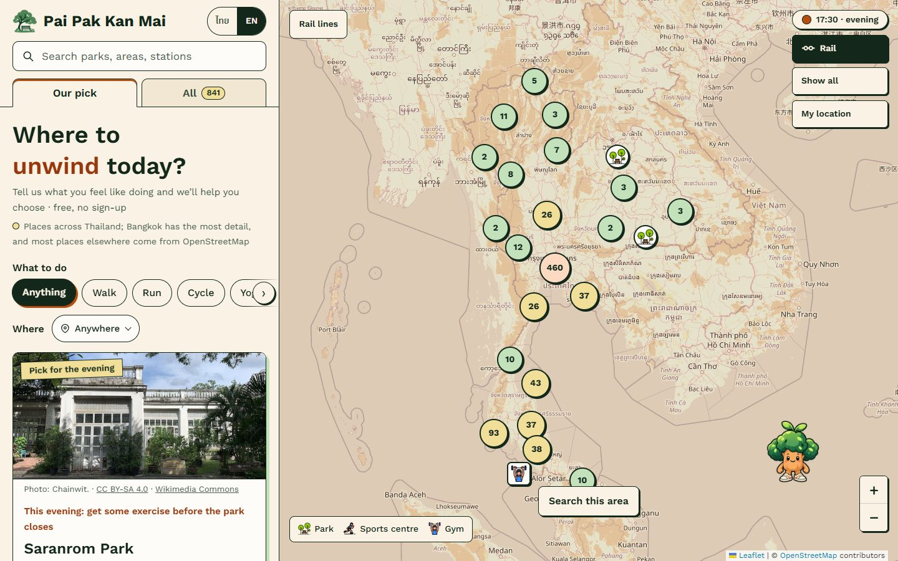
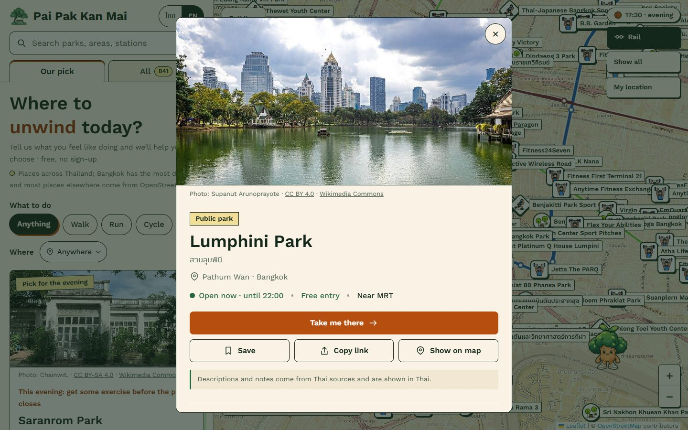
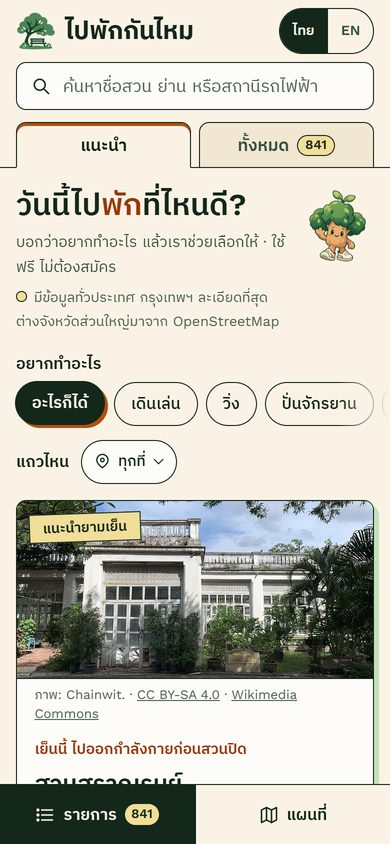

# Pai Pak Kan Mai (ไปพักกันไหม)

**Where to unwind today?** A bilingual (Thai / English) map that helps people in Thailand decide where to rest or exercise: parks, national and forest parks, sports grounds and gyms. It is free to use and needs no sign-up.

- Live site: **https://pai-pak-kan-mai.pages.dev**
- ภาษาไทย: [README.th.md](README.th.md) (Thai guide: features, running, updating data, deploying)



| Place details | On a phone |
|---|---|
|  |  |

## What it does

- **Helps you decide.** The "Our pick" tab suggests one place that suits the time of day in Bangkok and is open long enough to be worth the trip, with plain reasons ("open until 22:00 · free entry · near MRT").
- **841 places in 62 provinces.** Bangkok has the most detail (the city's 48 official parks, BMA sports centres and gym chains). Places elsewhere come from OpenStreetMap.
- **Honest about gaps.** Opening hours, fees and crowds are never guessed. Unknown values say so on screen, and every fact links to its source.
- **Find and filter.** Free-text search (place, district or rail station), "what do you want to do" chips, near me or a point on the map with a radius, province, open now, free entry, facilities, and a date and time to plan a visit.
- **Thai and English.** The whole UI switches language. A place shows a Thai or English name only when a source gives one; names are never machine-transliterated.
- **A living mascot.** Nong Nong Mai, a little tree in sneakers, wanders the map with his own needs (energy, boredom, company) and daily habits: jogging at dawn, napping in the afternoon, stargazing at night. Visitors can poke, drag and even throw him; he reads the name of the pin he lands on.
- **Accessible.** Keyboard and screen-reader support, WCAG AA contrast, 44 px touch targets on phones, and `prefers-reduced-motion` respected throughout (the mascot stops moving on his own).

## Tech

- Plain HTML, CSS and JavaScript ES modules. There is no framework and no build step; the deployable site is the `dist/` folder.
- [Leaflet](https://leafletjs.com/) with Leaflet.markercluster on OpenStreetMap tiles.
- Data pipeline: OpenStreetMap (Overpass, Nominatim), Wikidata, Wikimedia Commons and the owners' own pages. Each record keeps per-fact source URLs.
- Opening hours handle weekly schedules, split sessions, holidays and seasonal closures, all in Bangkok time.
- The mascot is a 2D sprite engine (8 walking directions, 22 animated actions) driven by a small behaviour model in [`dist/buddy.js`](dist/buddy.js).
- Tests: Node's built-in test runner (`node --test`) covers time logic, filters and ranking, data integrity and sourcing, translations, licences and the mascot engine.

## Run it locally

```bash
npm start      # serves dist/ at http://127.0.0.1:4173
npm test       # node --test tests/*.test.mjs
```

Requires Node.js 20 or newer. No dependencies to install.

## Project layout

```
dist/            the website (deploy this folder as static files)
  index.html     page shell
  app.js         UI, map and interaction
  core.js        search, filters, ranking ("why go") logic
  hours.js       opening-hours engine (Bangkok time)
  i18n.js        Thai/English strings and place-name translations
  buddy.js       the mascot's behaviour; buddy/ holds its sprite engine and atlases
  places.json    the place database (with sources)
  rail.json      rail lines and stations
tests/           automated tests
docs/            screenshots for this README
```

## Deploying

The site is static. Any static host works; Cloudflare Pages is recommended (build command: none, output directory: `dist`). It is live on Cloudflare Pages; every push to `main` redeploys it. If the site moves to its own domain, update `og:url`, `og:image` and the canonical link in `dist/index.html`. See the deploy section of [README.th.md](README.th.md) for details.

## Visitor statistics

Visits are counted with Cloudflare Web Analytics: no cookies, no personal data, nothing in the page code. After deploying to Cloudflare Pages, enable it under the project's **Metrics → Web Analytics**. The site's privacy page already says so.

## Licences

Code is MIT ([LICENSE](LICENSE)). The mascot and logo are © chanapoom, all rights reserved. Place data includes OpenStreetMap data (ODbL), and photos keep their own Creative Commons licences. See [NOTICE.md](NOTICE.md).

## Author

Built by **chanapoom**, with AI coding assistance.
